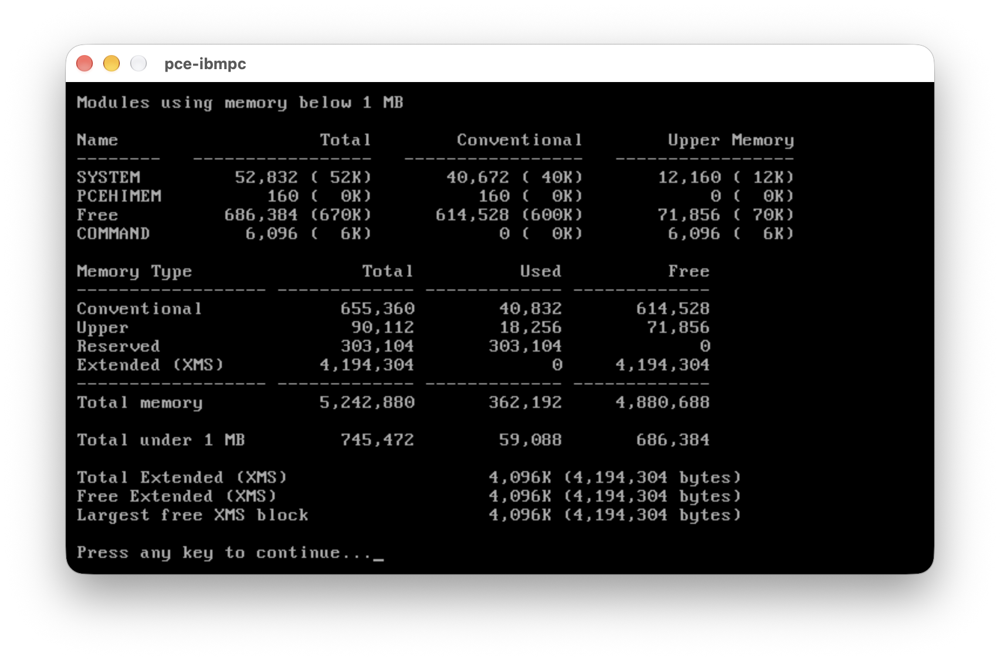
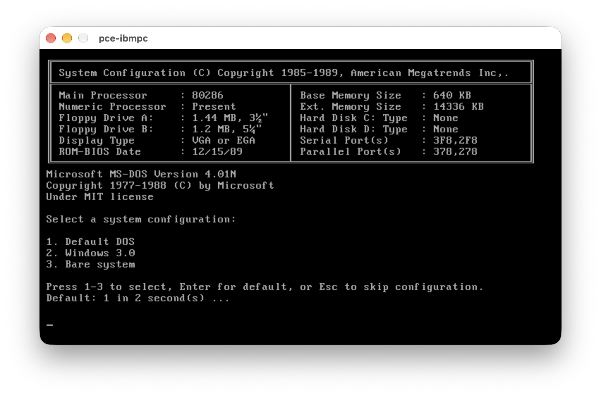
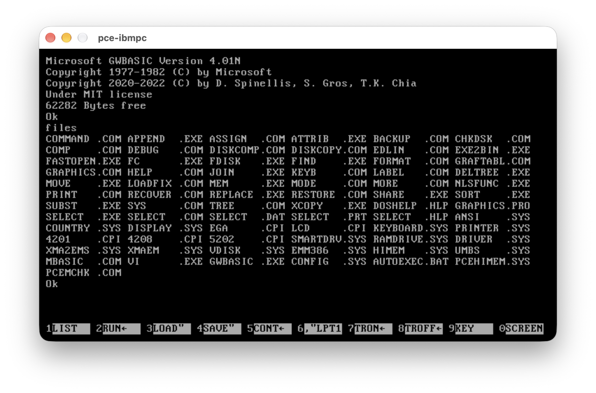
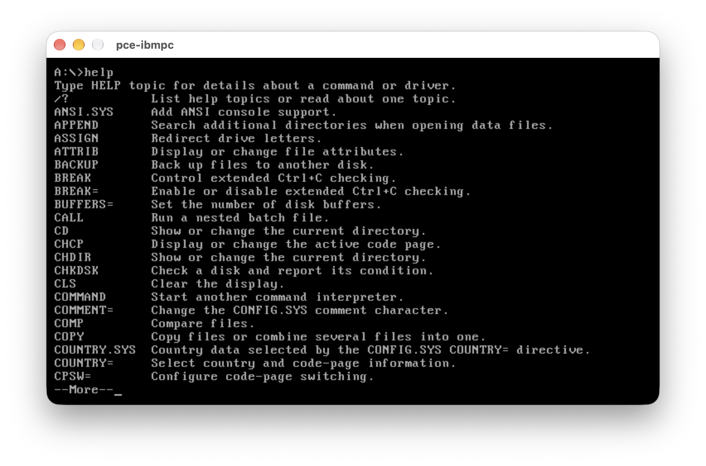
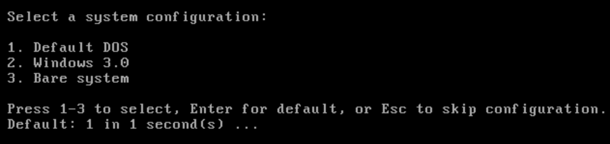
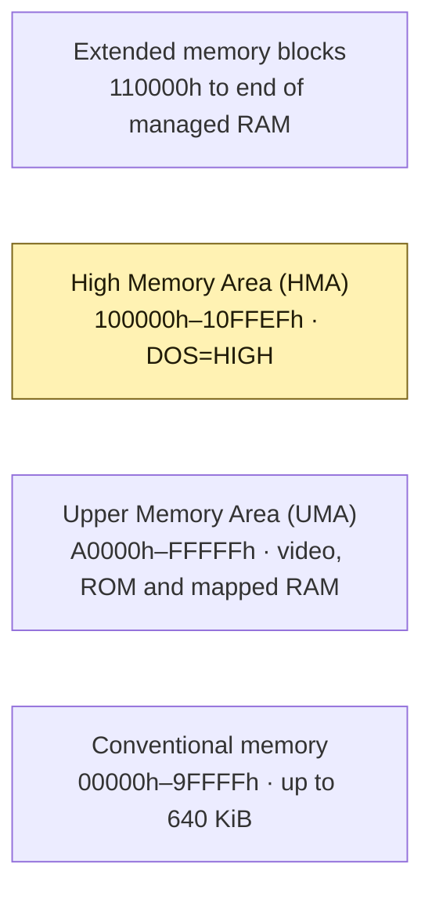

# MS-DOS 4.01 rebuild, distribution and extensions

MS-DOS 4.01 rebuilt on Unix with GNU make and the original tools under `emu2`. The goal is a usable replacement for DOS 3.3 and 5.0. This project will carry on iteratively, also reviewing/fixing the original code to be both robust and dependable. It is a permissive opensource, lightweight, nimble cousin of freedos and opendos keeping close to the microsoft/ibm commercial dos versions. The version tag is 4.01N.

_**Status Summary v1.8.0**: We already have:_
- _native `HIMEM.SYS` for XMS 2.0 on AT-compatible 286 and later systems. and extended memory management of vdisk, ramdrive and smartdrv moved to XMS_
- _HMA,UMB support with placement configurability for a large part of DOS and installed drivers and software (Up to 615KB of free application memory)_
- _all common commands are in line with DOS 5.0 with a few DOS 6.22 commands added._
- _support for up to 8 hard drives._
- _EGA and VGA graphics modes for the rebuilt GW-BASIC interpreter_

_Some deliverate choice are made no to close the following gaps (doskey replaced only by simple command line editing, undelete/unformat, 2.88MB floppy format)._

_The remaining gaps are in the work:_
- _completion of emm386 functionalities in line with DOS 5.0_
- _setver_
- _more to UMB and HMA_
- _Save As for EDIT_

We are progressing along the following roles:

| Goal | Details |
|---|---|
| **Stability** | Apply the documented Microsoft and IBM fixes and regression-test the rebuilt system. Progressive focused review of the whole code base |
| **Memory** | Surpass DOS 3.3 and approach DOS 5.0, targeting at least 610 Kbytes free. UMB allocation and XMS reporting are available. Strong XMS, EMS, HMA, UMB implementations, Selected kernel services can run in the HMA or UMB and Main DOS to UMB |
| **Storage** | Support for up to 8 physical disks, Integration of all patches, reliability testing |
| **Usability** | Stay MS-DOS, smooth the angles. Command-line editing and recall, clearer memory diagnostics, the EDIT screen editor and GW-BASIC on the full floppy. |
| **Compatibility** | Match closely or exceed DOS 5.0 commands and functionality. For example some 6.X DOS command have been reimplemented and Y2K has a stronger enforcement (4 digit dates are mandatory) |

<p align="center">


<br><sub>Memory report &nbsp;·&nbsp; Boot configuration menu</sub><br>


<br><sub>GW-BASIC &nbsp;·&nbsp; Command and driver help</sub>
</p>

## Sources

Based on hharte’s [4.01 reconstruction](https://github.com/lotharsm/MS-DOS/tree/dos-4.01-reconstructed) of the [released MS-DOS sources](https://github.com/microsoft/MS-DOS).

| Directory | Contents |
|---|---|
| `boot/`, `kernel/` | Boot sector, `io.sys`, `msdos.sys`, drivers and code pages |
| `commands/` | `command.com`, external commands and `select` |
| `common/`, `mapper/`, `messages/` | Shared objects, libraries and messages |
| `asminc/`, `include/`, `sdk/` | Headers and vintage build tools |
| [`edit/`](edit/README.md) | Full-screen DOS text editor derived from Kilo |
| [`gwbasic/`](gwbasic/README.md) | Microsoft GW-BASIC with the MIT-licensed PC reconstruction by Diomidis Spinellis, Stjepan Gros and TK Chia |
| `media/` | Floppy image rules and startup files |

## System fixes

### Historical changes

The 4.01 reconstruction changes 12 source files and corrects encoding in 17 others.

| Component | 4.01 change |
|---|---|
| `command.com`, messages | Display 4.01 at startup and in `ver`. |
| `msdos.sys`, `format` | Use the high word of disk sector numbers. |
| `fastopen` | Follow the extent chain on truncation. |
| `msdos.sys` | Remove the EMS map restore from the Ctrl-C path. |
| `io.sys` | Accept another boot-sector OEM name pattern. |
| `select` | Restore CP437 panel borders. |
| `setenv.bat` | Update original tool paths. This tree uses makefiles. |

| Later patch | Component | Fix |
|---|---|---|
| Microsoft PD0255 | `msdos.sys` | Correct directory creation and file appends near 32 MB boundaries. |
| Microsoft PD0255 | `graphics.com` | Avoid the `mscdex` multiplex number. |
| IBM UR31300, IR80263 | `ansi.sys` | Fix Shift-PrtSc above 25 rows. |

### Project fixes

| Component | Fix |
|---|---|
| `io.sys` | Assign letters through Z: to one DOS primary per BIOS disk (active first), then logical volumes, then remaining DOS primaries. |
| `fdisk` | Return errorlevel 1 for invalid switches or a missing or out-of-range disk number. |
| `fdisk` | Clear the last deleted logical drive and skip logical writes after extended partition deletion. |
| `fdisk` | Stop on partition-record write errors and return errorlevel 1. |
| `fdisk` | Prevent logical-drive table overflow by rejecting partition chains longer than 23 entries. |
| `format` | Stop on a failed final FAT write. Update the partition type only for the matching volume. |

Review driven fixes can be looked at in [REVIEW.md](commands/REVIEW.md)

## Command-line editing

| Key | Action |
|---|---|
| Left, Right / Home, End | Move one character / move to either end. |
| Ins | Toggle insert (default) and overwrite. |
| Del / Backspace, Ctrl-H | Delete under / before the cursor. |
| Up / Down | Recall the previous line on an empty prompt / ignore. |
| Esc / Enter | Discard / submit the whole line. |

Applies to `command.com` and DOS buffered console input. Cooked handle reads support editing without recall. For historical editing, set `LINEEDIT EQU 0` in `kernel/dos/editsw.inc` and rebuild. Test with `test/check_edit`.

## Y2K and calendar dates

Enter a four-digit year from 1980 through 2099 in `DATE`, `XCOPY /D`, `BACKUP /D`, and the `RESTORE /A` and `/B` filters. The configured country determines field order. For US settings, use `DATE 02-29-2000`. Batch files that supply two-digit years must be updated.

`DIR` displays four-digit years by default. Use `DIR /2Y` for the original column layout, or `SET DIRCMD=/2Y` to make it the default. `DIR /-2Y` overrides that preset. DOS date APIs and FAT timestamps retain their existing formats.

On the tested PCE 5170, DOS read the cold-boot date of 2000-01-02 correctly. The DOS date API and FAT timestamps advanced correctly across New Year 2000, February 29, and March 1.

## Command enhancements

The survey compares the commands shipped here with the command syntax and options in the [Microsoft MS-DOS 5.0 distribution](https://www.pcjs.org/software/pcx86/sys/dos/microsoft/5.00/) (720 KB disk set). “No known gaps” covers that interface. Hardware behavior, diagnostics, and application-level compatibility require separate testing. The inventory uses Microsoft's DOSHELP command list, the batch syntax in COMMAND.COM, and the executables on the three distribution disks. Availability is checked against the project's full floppy.

| Command | MS-DOS 5.0 comparison | Enhancement | Missing MS-DOS 5.0 features |
|---|---|---|---|
| `attrib` | No known flag gaps | `+H` / `-H` and `+S` / `-S` set or clear hidden and system file attributes. |  |
| `backup` | Gaps identified |  | *won't implement — The 2.88 MB disk size for `/F` (including `/F:2880`).* |
| `comp` | No known gaps | `/D` reports decimal bytes, `/A` shows characters, `/L` reports line numbers, `/N=n` limits comparison to the first *n* lines, and `/C` ignores ASCII letter case. |  |
| `copy` | No known gaps | `/Y` allows overwriting. `/-Y` prompts before overwriting. `COPYCMD` presets either switch. The last explicit overwrite switch wins. |  |
| `debug` | No known gaps | Type `?` at the debugger prompt for a one-screen command reference, including the EMS commands in the shipped build. |  |
| `del` (`erase`) | No known gaps | `/Q` skips the bulk-delete confirmation. An explicit `/P` still prompts for each file. |  |
| `dir` | No known gaps | `/B` prints bare names, one per line. `/L` displays ASCII letters in filenames in lowercase. `/A[:]` filters by D, R, H, S, or A. `/O[:]` orders by N (name), E (extension), S (size), D (date), or G (directories first). `/2Y` restores two-digit year display. Prefix a letter with `-` to exclude an attribute or reverse a key. `/P` pages console output. `DIRCMD` presets switches, and `/-` disables a preset switch on the command line. `/W` displays dotted filenames and brackets directory names. `/S` lists matching entries in subdirectories. With `/B`, it prints full paths. |  |
| `edit` | Project command | Kilo-based full-screen text editor, built with Microsoft C 5.1. [Usage and limits](edit/README.md). |  |
| `diskcopy` | No known gaps | `/V` asks the disk driver to verify each destination track after writing it. |  |
| `emm386` | Missing command |  | The EMM386.EXE command interface for querying and changing expanded-memory operation. The full floppy ships EMM386.SYS. |
| `fastopen` | No known gaps | Cache paths on up to 24 fixed-disk volumes (`C:` through `Z:`) across eight BIOS hard disks. |  |
| `fc` | No known gaps | In text mode, `/Dcount` or `/number` sets the number of matching lines needed to resume comparison. `/N` shows line numbers. |  |
| `fdisk` | No known gaps | Manage up to eight BIOS hard disks. `/STATUS` reports disk usage and DOS volumes. `/MBR` restores the master boot code on the first fixed disk. It preserves partition entries when the boot signature is present and installs an empty table when it is absent. |  |
| `find` | No known gaps | `/I` ignores case when matching and preserves the spelling of displayed lines. |  |
| `format` | Gaps identified | `/Q` quick format. | *won't implement — Recoverable formatting, `/U`, and `/F` for 2.88 MB media.* |
| `gwbasic` | Project extra | Run a BASIC program or start the interactive editor. See `HELP GWBASIC` for options. |  |
| `help [command]` | Project extra | With no argument, HELP pages the topic index on the console. Specify a topic for a one-screen reference. |  |
| `if` | No known gaps | `IF [NOT] DIREXIST path command` tests for a directory. Wildcards match directories only. |  |
| `keyb` | No known gaps | `/E` selects enhanced keyboard handling when installing on XT or AT. |  |
| `deltree` | Project extra | Delete files and directory trees, including protected files. Use `/Y` to skip confirmation. |  |
| `loadfix` | No known gaps | Run a DOS executable above the first 64 KiB and return its exit code. |  |
| `loadhigh` (`lh`) | No known gaps | Run an external program in upper memory when it fits. |  |
| `mem` | Gaps identified | Show total, used, and free memory by pool and the largest usable blocks. `/C` (`/CLASSIFY`) groups modules by memory usage. Combine `/P` with `/C` or `/D` (`/DEBUG`) to page console output. Alone, `/P` pages the summary. | `/PROGRAM` lists loaded programs. |
| `move` | Project extra | Move files within or between drives, or rename a directory in its parent. |  |
| `more [filename]` | No known gaps | Page a file by name. |  |
| `printfix` | Missing command |  | Suppress printer status checks for printers that cannot answer them. |
| `restore` | No known gaps | `/D` lists matching backup paths and preserves destination files. |  |
| `select` | No same-name DOS 5.0 utility | `SELECT MENU` installs DOS from the distribution or full floppy. Both install `HIMEM.SYS` and `UMBS.SYS` for optional configuration. The full floppy also installs `GWBASIC.EXE`. |  |
| `setver` | Missing command |  | Display or edit the per-program DOS version table. |
| `sys` | Gaps identified |  | *won't implement — Transfer `COMMAND.COM`, recognize both IBM and Microsoft system-file names when replacing an installation, and allow the first three contiguous sectors of `IO.SYS` to reside later in the data area. The placement change also requires boot-loader support.* |
| `tree` | No known gaps | `/L` displays directory names in lowercase. Combine it with `/A` for ASCII branches or `/F` to include files. |  |
| `ver` | No known gaps | Displays the project version as `4.01N`. |  |
| `xcopy` | No known gaps | `XCOPYCMD` presets XCOPY switches. Explicit switches take precedence. For example, `SET XCOPYCMD=/S /E` includes empty subdirectories and `XCOPY source dest /-S /-E` copies only the top level. |  |

| Status | Commands |
|---|---|
| *Won't implement* | *`cv`, `doskey`, `dosshell`, `expand`, `mirror`, `msherc`, `qbasic`, `setup`, `undelete`, `unformat`* |
| No known gaps | `append`, `assign`, `break`, `call`, `cd` (`chdir`), `chcp`, `chkdsk`, `cls`, `command.com`, `ctty`, `date`, `diskcomp`, `echo`, `edlin`, `exe2bin`, `exit`, `for`, `goto`, `graftabl`, `graphics`, `join`, `label`, `md` (`mkdir`), `mode`, `nlsfunc`, `path`, `pause`, `print`, `prompt`, `rd` (`rmdir`), `recover`, `rem`, `ren` (`rename`), `replace`, `set`, `share`, `shift`, `sort`, `subst`, `time`, `truename`, `type`, `verify`, `vol` |

The batch comparison covers `CALL` with arguments, `ECHO` and leading `@`, `FOR %%v IN (...) DO`, `GOTO` and labels, `IF [NOT]` with ERRORLEVEL, string equality or EXIST, `PAUSE`, `REM`, `SHIFT`, positional arguments and environment expansion. All eight DOS 5.0 batch commands are present. A batch fixture booted on both systems produced identical output for CALL/SHIFT, FOR, IF, GOTO, environment expansion and a blank ECHO line. Individual command rows record project extensions.

## Driver enhancements

| Driver | Functionality |
|---|---|
| `ANSI.SYS` | Cursor positioning and position reports use the active video page. `HELP ANSI.SYS` documents cursor control, position reporting and erase sequences. |
| `HIMEM.SYS` | Native XMS 2.0 on AT-compatible 286 and later systems. Manages A20, the HMA for `DOS=HIGH`, and extended-memory blocks. [MIT license](kernel/himem/LICENSE.md). |
| `RAMDRIVE.SYS` | `/E` creates the RAM disk in XMS. `/A` selects EMS. |
| `SMARTDRV.SYS` | Uses XMS for the disk cache by default. `/A` selects EMS. |
| `UMBS.SYS` | Supplies upper memory from configured ranges of mapped RAM. Load after `HIMEM.SYS` to use XMS and UMBs together. [Public domain, Marco van.Zwetselaar](kernel/umbs/LICENSE.md), Original USE!UMBS sources are in the component source directory in full and have been adapted to MASM |
| `VDISK.SYS` | `/E` creates the virtual disk in XMS. `/X` uses a DOS-reserved EMS page. |

## Configuration enhancements

An optional `\BOOT.SYS` on the boot drive selects a complete configuration at startup.

```ini
# File = menu description
C:\CONFIG.SYS = Default DOS
C:\WIN30.SYS = Windows 3.0
C:\BARE.SYS = Bare system
default = 1
timeout = 2
```



DOS lists up to nine entries in file order. A digit selects a file, Enter selects the default, and Esc skips configuration for this boot. The default is entry 1 and the timeout is 2 seconds. A single entry or a zero timeout starts immediately. An absent or empty menu uses the ordinary `\CONFIG.SYS`. If a selected file is missing, DOS displays its name and continues to the shell.

AUTOEXEC.BAT can use `%DOSCFG%` to identify the configuration DOS loaded. For example, `A:\PROFILES\win30.sys` gives `WIN30`, and ordinary `CONFIG.SYS` gives `CONFIG`. Esc or a missing configuration file leaves the variable unset.

| Directive | MS-DOS 5.0 comparison | Enhancement | Missing MS-DOS 5.0 features |
|---|---|---|---|
| `break=` | No known syntax gaps |  |  |
| `buffers=` | Placement gap | Place the primary buffer pool in one UMB when it fits. | DOS 5.0 can keep disk buffers in available HMA space with `DOS=HIGH`. |
| `comment=` | Present in both parsers |  |  |
| `country=` | No known syntax gaps |  |  |
| `cpsw=` | Project's DOS 4.x directive |  |  |
| `device=` | Driver availability gaps | `UMBS.SYS start-end [start-end ...]` supplies mapped RAM as UMBs. Ranges are hexadecimal segments with exclusive ends. | The DOS 5.0 SETVER.EXE version-table driver and EMM386.EXE memory manager. |
| `devicehigh=` | Gaps identified | Try upper memory first and fall back to conventional memory. | `DEVICEHIGH SIZE=hexsize driver` specifies a minimum upper-memory block size. |
| `dos=` | Gaps identified | `HIGH` moves selected kernel routines into the HMA. `UMB` enables upper memory from an XMS provider. With `UMB`, DOSCODE uses one contiguous UMB if available. With both options, DOS tries HMA first, then UMB. Conventional memory is the fallback. | Explicit `LOW` and `NOUMB` keywords. |
| `drivparm=` | Gaps identified |  | `/F:9` for a 2.88 MB floppy. The project's geometry table ends at `/F:7`. |
| `fcbs=n,m` | No known syntax gaps | Place the FCB table in one UMB when it fits. |  |
| `files=` | No known syntax gaps | Place the file table extension in one UMB when it fits. The first five entries stay in the kernel. |  |
| `install=` | No known syntax gaps |  |  |
| `lastdrive=` | No known syntax gaps | Place the permanent current-directory table in one UMB when it fits. |  |
| `multitrack=` | Present in both parsers |  |  |
| `rem` | No known syntax gaps |  |  |
| `shell=` | No known syntax gaps |  |  |
| `shellhigh=` | Project extra | Try upper memory for the shell and the permanent COMMAND.COM environment. Each falls back independently. |  |
| `stacks=` | No known syntax gaps | Place interrupt handlers and stacks together in one UMB when they fit. |  |
| `switches=` | Gaps identified | Add `SWITCHES=/FASTFREE` to `CONFIG.SYS` to speed up free-space queries such as `DIR` on local fixed FAT16 drives. DOS counts one FAT sector at a time when it needs a fresh count. Off by default. | `/T` (BIOS midnight rollover handling) and `/W` (Windows WINA20.386 loading). |

The directive inventory comes from the keyword tables in both versions of IO.SYS. Parser coverage does not establish hardware or driver compatibility. [MS-DOS 5.0 distribution](https://www.pcjs.org/software/pcx86/sys/dos/microsoft/5.00/), [Microsoft CONFIG.SYS defaults](https://jeffpar.github.io/kbarchive/kb/077/Q77052/), [Microsoft floppy geometry reference](https://minuszerodegrees.net/ms_kb_articles/Q75131%20revision%202.pdf).

Measured conventional-memory savings on PCE¹ are 7,504 bytes for `DOS=HIGH`, 4,544 for `DEVICEHIGH=ANSI.SYS`, 6,096 for `SHELLHIGH=COMMAND.COM /P /E:160`, 10,640 for `BUFFERS=20`, 3,296 for `STACKS=9,128`, 272 for `FCBS=4,1`, 464 for `LASTDRIVE=E` (2,304 for Z), and 912 for `FILES=20`.

Use `FILES=80 /L` with Windows 3.0 to keep the System File Table in conventional memory while retaining `DOS=HIGH,UMB`. `FCBS` and `STACKS` also accept `/L`. For `BUFFERS`, `/X /L` tries EMS then conventional memory.

On an AT-compatible 286 or later, SELECT installs the native driver in the
chosen DOS directory. To enable the HMA with the default installation path,
add these lines to CONFIG.SYS and reboot.

```dos
DOS=HIGH
DEVICE=C:\DOS\HIMEM.SYS
```

PCE example for `config.sys`

```dos
dos=high,umb
files=20
buffers=20
fcbs=4,1
lastdrive=e
device=pcehimem.sys
devicehigh=ansi.sys
shellhigh=command.com /p /e:160
```

¹ PCE XT with 512-byte floppy sectors. With 88 Kbytes of UMB and the HMA enabled, the example above gives a 614,448-byte largest executable (600 KiB plus 48 bytes). The launcher configuration in `pceconfig.sys` gives the same result.

For an AT with unused RAM mapped from segment `ca00` up to `e000` (exclusive), load the native drivers in this order. Substitute the range mapped on your machine.

```dos
dos=high,umb
device=c:\dos\himem.sys
device=c:\dos\umbs.sys ca00-e000
devicehigh=c:\dos\ansi.sys
shellhigh=command.com /p
```

Programs can link UMBs with `int 21h/5803h` and select upper-only or upper-first allocation with `5801h`.

### AT memory layout

Physical addresses increase from bottom to top. This layout assumes the
native HIMEM driver and at least 64 KiB of extended RAM.



Real-mode addressing reaches 65,520 bytes above 1 MiB. HIMEM rounds its HMA
reservation to 64 KiB and allocates extended-memory blocks above it. Within
the UMA, `UMBS.SYS` can supply unused mapped RAM for `DOS=UMB` and
`DEVICEHIGH`. [Native HIMEM driver](kernel/himem/README.md)

## Companion projects

| Project | Description |
|---------|-------------|
| [ccpm86-kernel](https://github.com/tsupplis/ccpm86-kernel)         | CCP/M-86 3.1 distribution rebuilt from patched and reconstituted sources |
| [cdos41-kernel](https://github.com/tsupplis/cdos41-kernel)         | Concurrent DOS 4.1 distribution rebuilt from patched and reconstituted sources |
| [cpm86-kernel](https://github.com/tsupplis/cpm86-kernel)     | CP/M-86 1.1 distribution rebuilt from patched and reconstituted sources |
| [cpm86-crossdev](https://github.com/tsupplis/cpm86-crossdev) | Unix CP/M-86 cross development project (compilers, emulation and tools) |
| [cpm86-hacking](https://github.com/tsupplis/cpm86-hacking)   | CP/M-86 miscellaneous tools and PCE emulator helpers |
| [cpm86-cmdtools](https://github.com/tsupplis/cpm86-cmdtools) | CP/M-86 `.cmd` file manipulation tools |
| [cpm86-ports](https://github.com/tsupplis/cpm86-ports)       | CP/M-86 application ports in C and assembler |
| [cpm86-msbasic](https://github.com/tsupplis/cpm86-msbasic)   | A recreation of msbasic-86 for CP/M-86 and PC-DOS 1.1 from gwbasic sources |
| [cpm86-menu](https://github.com/tsupplis/cpm86-menu)   | A submit replacement and a menu system for submit orchestration for CP/M-86 1.1 |
| [cpm86-make](https://github.com/tsupplis/cpm86-make)   | A simple submit based make tool for CP/M-86 |
| [pcdos11-hacking](https://github.com/tsupplis/pcdos11-hacking) | PC-DOS 1.1 distribution, tools and notes |
| [msdos40-kernel](https://github.com/tsupplis/msdos40-kernel) | MS-DOS 4.0 distribution, tools and notes |

---

## License

MIT unless a subdirectory specifies otherwise. [license.md](LICENSE.md)

## Credits

| Project | Credit |
|---|---|
| emu2 | emu2 runs the original DOS build tools and command tests. Thanks to dmsc for the original emulator and to johnsonjh for the CP/M-86 fork. [emu2](https://github.com/dmsc/emu2) · [emu2-cpm86](https://github.com/johnsonjh/emu2-cpm86) |
| PCE | Hampa Hug's emulator boots the DOS images for end-to-end regression tests. [PCE project](http://www.hampa.ch/pce/) |
| EDIT | EDIT derives from Kilo, written by Salvatore Sanfilippo (antirez) in 2016 and distributed under the BSD 2-Clause license. [Kilo source](https://github.com/antirez/kilo) · [License](edit/LICENSE.md) |
| GW-BASIC | GW-BASIC uses Microsoft's 1983 interpreter and the PC reconstruction by Diomidis Spinellis, Stjepan Gros and TK Chia, distributed under the MIT license. [Microsoft source](https://github.com/microsoft/GW-BASIC) · [Spinellis reconstruction](https://github.com/dspinellis/GW-BASIC) · [TK Chia fork](https://codeberg.org/tkchia/GW-BASIC) · [License](gwbasic/LICENSE.md) |
| FREESPT | Chartreuse (ChartreuseK) wrote FREESPT, which inspired the kernel's `/FASTFREE` scan for fixed FAT16 drives. [FREESP and FREESPT](https://github.com/ChartreuseK/FREESP) |
