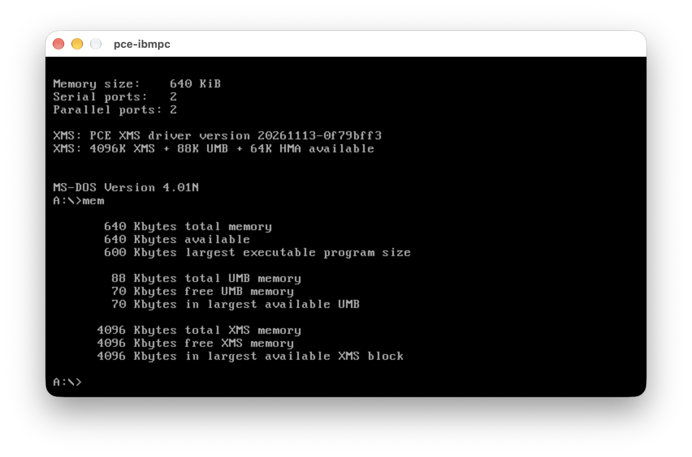

# MS-DOS 4.01 rebuild

MS-DOS 4.01 rebuilt on Unix with GNU make and the original tools under `emu2`. The goal is a usable replacement for DOS 3.3.

| Goal | Details |
|---|---|
| **Stability** | Apply the documented Microsoft and IBM fixes and regression-test the rebuilt system. |
| **Memory** | Surpass DOS 3.3 and approach DOS 5.0, targeting 610 Kbytes free. UMB allocation and XMS reporting are available. Selected kernel services can run in the HMA. |
| **Usability** | Command-line editing and recall, clearer memory diagnostics, BASIC (`mbasic.com`) and a screen editor (`vi.exe`) on the full floppy. |



## Sources

Based on hharte’s [4.01 reconstruction](https://github.com/lotharsm/MS-DOS/tree/dos-4.01-reconstructed) of the [released MS-DOS sources](https://github.com/microsoft/MS-DOS).

| Directory | Contents |
|---|---|
| `boot/`, `kernel/` | Boot sector, `io.sys`, `msdos.sys`, drivers and code pages |
| `commands/` | `command.com`, external commands and `select` |
| `common/`, `mapper/`, `messages/` | Shared objects, libraries and messages |
| `asminc/`, `include/`, `sdk/` | Headers and vintage build tools |
| `media/` | Floppy image rules and startup files |

## Historical changes

The 4.01 reconstruction changes 12 source files and corrects encoding in 17 others.

| Component | 4.01 change |
|---|---|
| `command.com`, messages | Display 4.01 at startup and in `ver`. |
| `msdos.sys`, `format` | Use the high word of disk sector numbers. |
| `fastopen` | Follow the extent chain on truncation. |
| `msdos.sys` | Remove the EMS map restore from the Ctrl-C path. |
| `io.sys` | Accept another boot-sector OEM name pattern. |
| `select` | Restore CP437 panel borders. |
| `setenv.bat` | Update original tool paths. This tree uses makefiles. |

| Later patch | Component | Fix |
|---|---|---|
| Microsoft PD0255 | `msdos.sys` | Correct directory creation and file appends near 32 MB boundaries. |
| Microsoft PD0255 | `graphics.com` | Avoid the `mscdex` multiplex number. |
| IBM UR31300, IR80263 | `ansi.sys` | Fix Shift-PrtSc above 25 rows. |

## Command-line editing

| Key | Action |
|---|---|
| Left, Right / Home, End | Move one character / move to either end. |
| Ins | Toggle insert (default) and overwrite. |
| Del / Backspace, Ctrl-H | Delete under / before the cursor. |
| Up / Down | Recall the previous line on an empty prompt / ignore. |
| Esc / Enter | Discard / submit the whole line. |

Applies to `command.com` and DOS buffered console input. Cooked handle reads support editing without recall. For historical editing, set `LINEEDIT EQU 0` in `kernel/dos/editsw.inc` and rebuild. Test with `test/check_edit`.

## Command enhancements

| Command | Enhancement |
|---|---|
| `mem` | Report memory in whole Kbytes, including total, free and largest free blocks for UMB and XMS pools. |
| `more [filename]` | Page a file or, with no filename, standard input. |
| `loadhigh` (`lh`) | Run an external program in upper memory when it fits. |
| `vi.exe` | Screen editor on the full floppy. |
| `mbasic.com` | BASIC interpreter on the full floppy. |
| `device=umbs.sys start-end [start-end ...]` | Supply unused, mapped RAM as UMBs. Use four-digit hex segments with an exclusive end. Each range is granted whole. |

## Configuration enhancements

| Directive | Enhancement | Conventional bytes saved on PCE¹ |
|---|---|---:|
| `dos=high` | Place filename parsing, directory search, local pathname lookup and file I/O in the HMA when available. Combine with `dos=high,umb` for UMBs. | 5,280 with the PCE configuration below |
| `dos=umb` | Enable upper memory blocks (UMBs) from an XMS provider. | — |
| `devicehigh=driver [arguments]` | Try upper memory first, then conventional memory if the image cannot fit. | 4,544 with `ansi.sys` |
| `shellhigh=interpreter [arguments]` | Try upper memory for the shell and, for permanent `command.com`, its `/e:bytes` environment. Each falls back independently. | 6,096 with `command.com /p /e:160` |
| `buffers=` | Place the primary buffer pool in one UMB when it fits. | 10,640 with `buffers=20` |
| `stacks=` | Place interrupt handlers and stacks together in one UMB when they fit. | 3,296 with `stacks=9,128` |
| `fcbs=n,m` | Place the FCB table in one UMB when it fits. | 272 with `fcbs=4,1` |
| `lastdrive=` | Place the permanent current-directory table in one UMB when it fits. | 464 with `lastdrive=e`, 2,304 with `lastdrive=z` |
| `files=` | Place the file table extension in one UMB when it fits. The first five entries stay in the kernel. | 912 with `files=20` |

PCE example for `config.sys`

```dos
dos=high,umb
files=20
buffers=20
fcbs=4,1
lastdrive=e
device=pcehimem.sys
devicehigh=ansi.sys
shellhigh=command.com /p /e:160
```

¹ PCE XT with 512-byte floppy sectors. With 88 Kbytes of UMB and the HMA enabled, the example above gives a 598 Kbyte largest executable.

For a machine with unused RAM mapped from segment `ca00` up to `e000` (exclusive), use `umbs.sys` as the provider.

```dos
dos=umb
device=umbs.sys ca00-e000
devicehigh=ansi.sys
shellhigh=command.com /p
```

Programs can link UMBs with `int 21h/5803h` and select upper-only or upper-first allocation with `5801h`.

## Companion projects

| Project | Description |
|---------|-------------|
| [ccpm86-kernel](https://github.com/tsupplis/ccpm86-kernel)         | CCP/M-86 3.1 distribution rebuilt from patched and reconstituted sources |
| [cdos41-kernel](https://github.com/tsupplis/cdos41-kernel)         | Concurrent DOS 4.1 distribution rebuilt from patched and reconstituted sources |
| [cpm86-kernel](https://github.com/tsupplis/cpm86-kernel)     | CP/M-86 1.1 distribution rebuilt from patched and reconstituted sources |
| [cpm86-crossdev](https://github.com/tsupplis/cpm86-crossdev) | Unix CP/M-86 cross development project (compilers, emulation and tools) |
| [cpm86-hacking](https://github.com/tsupplis/cpm86-hacking)   | CP/M-86 miscellaneous tools and PCE emulator helpers |
| [cpm86-cmdtools](https://github.com/tsupplis/cpm86-cmdtools) | CP/M-86 `.cmd` file manipulation tools |
| [cpm86-ports](https://github.com/tsupplis/cpm86-ports)       | CP/M-86 application ports in C and assembler |
| [cpm86-vi](https://github.com/tsupplis/cpm86-vi)             | STevie vi port for CP/M-86 and PC-DOS |
| [cpm86-msbasic](https://github.com/tsupplis/cpm86-msbasic)   | A recreation of msbasic-86 for CP/M-86 and PC-DOS 1.1 from gwbasic sources |
| [cpm86-menu](https://github.com/tsupplis/cpm86-menu)   | A submit replacement and a menu system for submit orchestration for CP/M-86 1.1 |
| [cpm86-make](https://github.com/tsupplis/cpm86-make)   | A simple submit based make tool for CP/M-86 |
| [pcdos11-hacking](https://github.com/tsupplis/pcdos11-hacking) | PC-DOS 1.1 distribution, tools and notes |
| [msdos40-hacking](https://github.com/tsupplis/msdos40-hacking) | MS-DOS 4.0 distribution, tools and notes |

---

## License

MIT unless a subdirectory specifies otherwise. [license.md](LICENSE.md)
